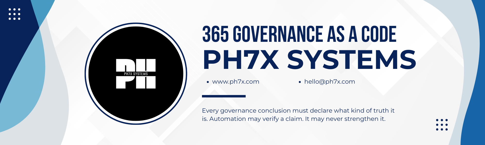

# Microsoft 365 Governance as Code

[](https://pypi.org/project/m365-governance-as-code/)
[](https://pypi.org/project/m365-governance-as-code/)
[](https://github.com/ph7x-Systems/m365-governance-as-code/blob/main/LICENSE)
[](https://github.com/ph7x-Systems/m365-governance-as-code/actions/workflows/ci.yml)
[](https://ph7x.com/tools/m365-governance-as-code/docs/)
[](https://github.com/ph7x-Systems/m365-governance-as-code/releases)
[](https://github.com/ph7x-Systems/m365-governance-as-code/blob/main/DCO.txt)

> Each badge reports something measured. The Python versions are the ones CI
> runs the suite against, and the CI badge is the state of `main`. None of them
> is a claim about the governance conclusions this engine produces; those
> declare their own basis, one rule at a time.


> **Every governance conclusion must declare what kind of truth it is.**
>
> **Automation may verify a claim. It may never strengthen it.**

Governance checks that show their work. PowerShell collects facts. Python
evaluates declarative rules. Every finding says what kind of claim it is,
which evidence it came from, and what it does not establish.

Nothing here changes anything in a tenant's content or settings. There is no
remediation command and no `--fix-all`. The one write is the application
registration `setup` makes, once, when an administrator agrees to it.

**Where this sits.** `m365-governance-as-code` is the engine, and it is MIT.
A commercial operator experience is being built on top of it, and saying so
here from the start is the point: reading an assessment and verifying one never
require a licence, an account or pH7x Systems, and if the commercial work stops,
the engine stays open. That is what the licence was chosen to guarantee rather
than a promise made in prose. There is nothing to buy in this repository and
there never will be.

**Scope.** This project evaluates the Microsoft 365 tenant that exists today.
It does not infer the characteristics of an estate it has not observed. There
are two modes, and the engine never knows which one produced the evidence it
is reading: **Live** observes Microsoft 365 directly, **Assessment** evaluates
evidence exported by something else and says so on the first line of every
report. See [docs/SCOPE.md](https://github.com/ph7x-Systems/m365-governance-as-code/blob/main/docs/SCOPE.md).

**Why it exists.** We kept writing the same governance findings into
documents, and kept watching them lose the one thing that made them useful:
whether the finding was a rule Microsoft enforces, a limit it imposes, advice
it gives, or our own opinion. This project is that distinction, made
executable and made impossible to skip.

**Status:** `1.0.0b6`. A thirteen-mode collector validated against a live
tenant, and a suite at 90 per cent coverage. What ships is what `doctor`,
`list-rules` and `--help` report; counts are not restated here, because a
number in prose is a second place for them to be wrong.

Beta because the model has stopped moving: the outcomes, the
resolution order, the basis types and the evidence schema are frozen, and
The rule set is still small, and that is a
statement about the rules rather than a caveat on the model.

---

## Install

Three supported platforms, and the instructions are equivalent on all three.
The first step installs `pipx`, which most systems do not ship.

**Windows.** Python 3.11 or later from [python.org](https://www.python.org/downloads/),
then in PowerShell:

```powershell
py -m pip install --user pipx
py -m pipx ensurepath
```

**macOS.**

```bash
brew install pipx
pipx ensurepath
```

**Linux.** Install `pipx` with your distribution's package manager, then
`pipx ensurepath`. The package is named `pipx` almost everywhere, and
`python-pipx` on Arch:

```bash
sudo apt install pipx      # Debian, Ubuntu
sudo dnf install pipx      # Fedora
sudo pacman -S python-pipx # Arch
sudo zypper install pipx   # openSUSE
```

Then, in a **new shell** on any of the three:

```bash
pipx install m365-governance-as-code==1.0.0b6
m365g doctor
m365g --version
```

`doctor` exits `0` and reports the packaged content; the version is the one you
installed.

**The command is `m365g`.** `m365-governance` is installed too and does exactly
the same thing, so anything already scripted against it keeps working; the
short name is the one documented, because it is the one you type dozens of
times in a session. The package, the schemas and the provenance recorded inside
every artefact are unchanged — this is the name of a command, not a rename of
anything else.

`pipx ensurepath` is not optional, and the new shell is part of the step rather
than a note beside it. pipx gives each application a directory of its own, and
that directory is not on your PATH until `ensurepath` puts it there — and a
shell already open never re-reads the profile it edits. Skip either and you get
`command not found: m365g` after an installation that succeeded, which reads
like a broken package.

`pipx` and not `pip`, and it is not a preference either. This is a command-line
application rather than a library you import, and a modern Python refuses to
install one into the system environment:

```text
error: externally-managed-environment
```

That is [PEP 668](https://peps.python.org/pep-0668/), enforced by Homebrew's
Python and by the distributions that ship one — including for installing pipx
itself, which is why the distribution's package is the way in on Linux rather
than `pip install --user`. Where a distribution has no package, pipx's own
documentation gives `python3 -m pip install --user pipx` followed by
`python3 -m pipx ensurepath`; the two cover each other, because the `--user`
path fails exactly on the distributions that ship the package.

If you would rather manage the environment yourself:

```bash
python3 -m venv .venv
./.venv/bin/pip install m365-governance-as-code==1.0.0b6
```

The `==` is not optional yet. `1.0.0b6` is a pre-release under PEP 440, and pip
skips pre-releases unless a version is pinned or `--pre` is given, so plain
`pipx install m365-governance-as-code` resolves to nothing until there is a
stable release.

The rules, profiles, schemas and the collector ship inside the package, so an
installed copy works from any directory. Nothing resolves against a checkout.

Requires Python 3.11 or later. The collector additionally requires
PowerShell 7 and PnP.PowerShell, and is not needed to run anything below.

To work on the project instead of using it:

```bash
python -m venv .venv && source .venv/bin/activate
pip install -e . && pip install -r requirements-dev.txt
```

### Your own rules

The packaged set is what runs when you supply nothing. A path replaces it
entirely:

```bash
m365g evaluate --rules ./my-rules --evidence ./evidence
```

**It replaces; it never merges.** Either the set that shipped with this
version, complete, or the set you supplied, complete. A rule set assembled
from both would exist only in the memory of whoever typed the command, and two
runs of the same version would stop meaning the same thing. Every report says
which of the two it used.

---

---

## Start here

Four commands from an empty machine to a report about your own tenant.

```bash
m365g engine setup      # 1. this machine, the application registration, the target
m365g login             # 2. sign in once; later commands use the session
m365g spo site list     # 3. read something, and see it in the terminal
m365g governance run    # 4. collect, evaluate, and write the report
```

`m365g` on its own prints where to start, and `m365g spo` (or `entra`, `exo`,
`rule`, `governance`, `evidence`, `migration`, `engine`) lists what a group
holds. Every earlier name still works: `m365g collect sites` and
`m365g spo site list` are one command.

**`setup` does the setting up.** In a terminal it checks this machine, installs
or updates PowerShell 7 and PnP.PowerShell to their latest stable release when
you agree, asks for your SharePoint address, and obtains the one thing nothing
here works without: an Entra ID application registration. PnP.PowerShell has
shipped no application of its own since 2.12.0, and one registration serves
every run.

- **You are an administrator:** `setup` registers it, after you agree. A browser
  opens; you sign in and consent. It asks for SharePoint `AllSites.FullControl`
  and Microsoft Graph `User.Read` and nothing else, where PnP's default would
  also ask for Group.ReadWrite.All, User.ReadWrite.All and
  TermStore.ReadWrite.All. The collectors call only PnP `Get-` cmdlets;
  SharePoint answers its permission and tenant-setting reads only under
  AllSites.FullControl ([COLLECTOR-LIVE-MATRIX](docs/COLLECTOR-LIVE-MATRIX.md)).
- **It already exists:** give `setup` its id.
- **You are not an administrator:** `setup` writes
  `m365-governance-admin-request.txt`, which says what an administrator runs and
  why. When they send the id back, run `setup --client-id <id>`.

The id and the address are written to `m365-governance.toml`, so that nothing is
retyped again. **That registration is the only write this engine makes**
(`D90`): only by `setup`, only on your explicit agreement, under your own
sign-in. Without a terminal `setup` asks nothing and agrees to nothing;
`--install` and `--register` say yes in advance, for scripts.

**No secret ever goes in that file.** A certificate password is named there by
the environment variable that holds it, never by its value: the file is
committed, copied into tickets and pasted into chats.

**`login` keeps a session, and only because you asked.** After it, the
SharePoint reads do not ask again. The token is written by the sign-in library
into the operating system's protected storage (the macOS Keychain, Windows data
protection, or the Linux keyring) and never passes through this engine; where
that storage cannot be established, `login` refuses rather than write a token
to a plain file. `m365g status` says which connection is active without
reaching the tenant, `m365g connection list` shows every stored one, and
`m365g logout` removes the stored sign-in. Without `login` every command signs
in for itself and leaves nothing behind. The reads outside SharePoint do not use a
session; [docs/CLI.md](docs/CLI.md) names them and says why.

**A read answers in the terminal, and the evidence is a separate thing.**
`m365g spo site list` prints what was read; `--output json|csv|md` chooses the
form. What is printed is a view. The evidence — the documents with their
provenance and coverage, which is what rules evaluate — is kept only where
`--evidence-out DIRECTORY` says, and the command says so every time.
`--help` on any read names what it reads, the permissions it needs, and the
rules it feeds.

**`connect` answers two questions and not one.** `Connect-PnPOnline` succeeds
with zero permissions granted, so signing in and being allowed to read are
reported separately:

```text
Summary
  identity       application
  method         certificate
  authentication established
  authorization  established
  reason         established
```

Every failure carries a `reason` a program can act on — `consent-required`,
`application-not-in-directory`, `blocked-by-policy` — rather than leaving a
consumer to match on whatever PnP.PowerShell printed.

**`run` says what it will not do before it does anything.** Every collection
this engine holds appears in the plan with a verdict, including the ones your
target cannot reach:

```text
Plan: 10 of 11 collections

  run      sites            every site this identity can enumerate
  ...
  not run  conditional-access  reads Microsoft Graph, and this engine never
                              acquires a token: set one to include it
```

A collection that was not attempted is not a resource that is not there, and no
rule over the evidence can recover what it would have said. `--dry-run` on
`setup`'s target prints the plan and reaches nothing at all.

---

## Without a tenant

Everything above needs Microsoft 365. Everything here does not: the rules, the
outcomes and the reports can be read, run and argued with against fixtures that
ship inside the package.
Five commands. All of them run offline, against fixtures. No tenant required.

```bash
#                             1. install (see Install)
m365g engine doctor         # 2. is anything broken here
m365g rule list             # 3. what ships with this version
m365g rule show SPO-LIST-001
m365g evidence evaluate --evidence <an-evidence-file.json>
```

Example evidence ships with the package. `doctor` confirms it is there, in the
`packaged content` line, but does not print the path. This does:

```bash
python -c "import m365_governance, pathlib; print(pathlib.Path(m365_governance.__file__).parent / 'data' / 'fixtures')"
```

`explain unknown` is the one to run second. The project rests on six words
being different from each other, and the difference between "we could not read
this" and "this is fine" is the whole of it.

`show-rule` is the one to run first. It prints the whole claim: the basis, the
rationale behind the severity, the evidence the rule cannot decide without,
the source, and how the rule can pass while the problem survives.

---

---

## The commands

Signing in, at the top level:

| | |
|---|---|
| `login` | Sign in to one tenant and keep the session for later commands. The only command that keeps one |
| `status` | Which connection later commands will use, from the local record. Reaches no tenant |
| `logout` | Remove a stored sign-in and its record (`--name`, `--all`) |
| `connection list` · `use NAME` · `remove NAME` | The stored connections |
| `connect` | Ask the tenant: whether the sign-in works, whether the identity may read, and why not where it does not. Collects nothing |

By group. The earlier name of each is in the second column and still works:

| | Earlier name | |
|---|---|---|
| `engine setup` | `setup` | Set this machine up: install what is missing, obtain the application registration (registering it when an administrator agrees), and write the target down |
| `engine doctor` | `doctor` | Python, dependencies, schemas, rules, profiles, and whether PowerShell is around |
| `engine capabilities` | `capabilities` | What this engine collects, decides and promises, and how far each read has been proved against a tenant |
| `engine contracts` | `contracts` | The contract bundle a consumer vendors: schemas, models, samples and a manifest |
| `spo …` · `entra …` · `exo …` | `collect SLICE` | One read against a tenant, shown in the terminal; `--evidence-out` keeps the evidence. `m365g spo` lists them |
| `evidence collect SLICE` | `collect SLICE` | The same read by its collection name |
| `evidence stats EVIDENCE` | `stats` | What a collector managed to see, before anything is evaluated |
| `evidence evaluate` | `evaluate` | Rules against evidence: one document or a directory of them |
| `governance run` | `run` | A configured target to a report. Plans, collects what the target reaches, evaluates and renders, and says which collections it did not attempt. `--only` limits it to named collections |
| `governance assess` | `assess` | Evaluate, and package the result so somebody else can check it without this engine |
| `governance verify` | `verify` | Check an assessment that arrived, without the engine that made it |
| `governance report RUN.json` | `report` | Re-render a stored run in another format, without evaluating again |
| `governance diff BEFORE AFTER` | `diff` | What moved between two assessments, and what that does not establish |
| `rule list` | `list-rules` | Every rule with the kind of claim it makes, strongest claim first |
| `rule show ID` | `show-rule` | One rule in full, including what it does not establish |
| `rule explain OUTCOME` | `explain` | What `pass`, `fail`, `unknown`, `not-applicable`, `invalid-evidence` and `error` mean, and what each is not |
| `rule validate` | `validate` | Every rule against the schemas and the invariants |
| `migration read` · `migration verify` | `migration-read` · `migration-verify` | What a move actually moved, from a read before it and one after |

`--output text|json|csv|md` chooses how a result is shown wherever a command
has those forms; [docs/CLI.md](docs/CLI.md) holds the full table of names, the
session rules and the precedence of the earlier spellings.

### When something does not work

| What you see | What it means | What to do |
|---|---|---|
| `not signed in` | No active connection, no `--client-id`, no project file | `m365g login`, or `m365g engine setup` if there is no application registration yet |
| `why: the sign-in was refused (consent-required)` | The directory knows the application and nobody consented | An administrator consents to its permissions in Microsoft Entra |
| `… (application-not-in-directory)` | That id is not an application in this tenant | Use the id of a registration in the tenant being read |
| `… (blocked-by-policy)` | A sign-in policy refused it | The Entra sign-in log names the policy |
| `signed in and was NOT permitted to read this` | Authorization, not authentication | `m365g connect` shows what the identity may read; `--help` on the read names its permissions |
| `refusing to keep a session` | No protected storage on this machine | Run without `login`, or use a certificate |
| `connection NAME: not used, it is for …` | The command is aimed at another tenant | `m365g connection use`, or `--connection NAME` |
| `the stored sign-in was NOT removed` | `logout` could not clear it; the record is kept on purpose | Run `logout` again; it may ask you to sign in first |

`diff` is the one a periodic audit needs:

```
## SPO-SITE-001

**pass → fail**

Evidence that moved:

| Path | Before | After |
|---|---|---|
| `owners.count` | 2 | 1 |
```

It reports the rule version alongside the outcome, because a result that moved
because somebody edited the rule is not a result that moved because somebody
removed an owner. `--fail-on-regression` exits non-zero when any rule left
`pass`, including for `unknown`: losing the answer is a regression too.

---

## The problem

Most governance tooling produces a green box. A green box has no grammar for
the difference between these four sentences:

- the product **enforces** this;
- the product **imposes** this boundary, and here is the number;
- Microsoft **recommends** this, and permits the alternative;
- **we think** this is a good idea.

Those four produce different conversations, different budgets and different
arguments with an auditor. A tool that renders them identically has removed
the only information the reader needed.

And a green box has no grammar for the most common outcome of all: *we could
not read this*. Missing evidence is a fact about collection, not a fact about
the resource, and the moment it renders as a pass the whole report becomes
unreliable in a way nobody can see.

---

## The trust model

Every rule declares a `basis`. There are five, and the distinction between
them is the point of the project:

| basis | Meaning | Requires |
|---|---|---|
| `requirement` | The product enforces this | a source |
| `documented-limit` | A boundary the product imposes, with a number | a source, and the limit stated next to the observed value |
| `documented-guidance` | Microsoft recommends it; the alternative is permitted | a source |
| `convention` | Widely held practice, documented by nobody | a rationale |
| `opinion` | Our position, stated as ours | a rationale |

**A source never decides the type.** An opinion may cite documentation. A
convention may cite documentation. The source explains the claim; it does not
change what kind of claim it is.

**The engine never classifies.** `basis` is authored by a person and carried
into the report unchanged. The schema verifies that it is present and
justified; it never infers what it should be. That boundary is the whole
difference between automation that verifies and automation that strengthens.

Six outcomes, and `unknown` is never a pass:

```
pass · fail · unknown · not-applicable · invalid-evidence · error
```

`error` is the only one a rule may not author a message for: it describes the
engine, not the resource.

Full model in [docs/TRUST-MODEL.md](https://github.com/ph7x-Systems/m365-governance-as-code/blob/main/docs/TRUST-MODEL.md).

---

## Architecture

```
collectors  ─→  evidence  ─→  engine  ─→  results  ─→  reports
                   ▲            ▲
                schemas      rules + profile
```

Evidence flows one way. Nothing downstream writes back.

Validation happens in six layers, ordered by **scope**, and every constraint
has exactly one owner — a constraint enforced in two places will diverge the
first time one of them is corrected:

| Layer | Scope | Example |
|---|---|---|
| 1 | the file is a document | duplicate YAML keys |
| 2 | one field | `basis` is one of five |
| 3 | one file, references followed | `required` equals what the rule consumes |
| 4 | every file | duplicate ids |
| 5 | the outside world | the source URL resolves |
| 6 | a person | the source still says what the rule claims |

Layer 6 is numbered like the others on purpose. No validator can prove that a
rule represents a document correctly, and pretending otherwise would be the
exact failure the trust model exists to prevent.

Details in [docs/ARCHITECTURE.md](https://github.com/ph7x-Systems/m365-governance-as-code/blob/main/docs/ARCHITECTURE.md) and
[docs/JSON-SCHEMA-PLAN.md](https://github.com/ph7x-Systems/m365-governance-as-code/blob/main/docs/JSON-SCHEMA-PLAN.md).


## A rule

```yaml
schema_version: "1.0"
id: SPO-SITE-001
version: "1.0"
title: A site should have at least two owners

basis:
  type: convention
  sources: []
  rationale: >
    Microsoft does not require a minimum number of owners, does not warn about
    a single owner, and does not prevent a site from having one. This is our
    recommendation, and an organisation may reasonably decline it.

severity:
  default: medium
  rationale: >
    The consequence is delay, not exposure. Access decisions queue behind a
    person who is not there.
  configurable: true

evidence_requirements:
  - path: owners.count
    type: integer
    required: true

condition:
  operator: less-than
  evidence: owners.count
  value: 2

limitations:
  passes_without_resolving: >
    Two owners who are dormant, who have left, or who do not know they own the
    site satisfy this rule completely. The count is two and nobody is able to
    act.
```

`passes_without_resolving` is mandatory. It answers one question — *how can
this rule pass while the problem survives?* — and it is a field of its own
rather than one entry in a list because it is the one that gets omitted. An
author who cannot answer it has not yet understood what the rule measures.

Rules execute no code. The condition grammar has twelve operators and no
escape hatch, because a rule that can execute stops being reviewable by
anyone who does not read the language it executes in.

---

## Evidence

```json
{
  "facts": {
    "owners": {
      "state": "observed",
      "direct": [{"principal_id": "user-1", "principal_type": "user"}],
      "groups": [{"principal_id": "group-1", "principal_type": "group",
                  "expansion": {"status": "not-attempted"}}],
      "expansion_complete": false,
      "minimum_count": 1
    }
  }
}
```

A group owner is one principal and may be forty people. When expansion is
incomplete the collector emits a **bound**, never a guess, and the engine
reasons from the bound:

- three direct owners and one unexpanded group proves `at least 3`, so
  `owners >= 2` is a **pass**, with certainty;
- one direct owner and one unexpanded group proves nothing about `owners < 2`,
  so the answer is **unknown**.

Without an upper bound the engine can prove `pass` and can never prove `fail`.
That table lives in [docs/ARCHITECTURE.md](https://github.com/ph7x-Systems/m365-governance-as-code/blob/main/docs/ARCHITECTURE.md), not in each
rule: a rule author declares the condition, and the engine decides what can be
concluded from what was collected.

`[]` means observed, and there are none. A fact that was not collected is
never an empty list.

---

## Output

```markdown
### SPO-LIST-001 v2.0

The list holds 148000 items, above Microsoft's documented limit of 100,000,
and still inherits its permissions. Inheritance can no longer be broken on
this list, so it cannot be given unique permissions later.

- Basis: **documented-limit** — a boundary the product imposes
- Severity: medium
- Evidence: `items.count` = 148000, `permissions.inheritance_broken` = false
- Source: SharePoint limits, Items in lists and libraries — checked 2026-08-05
```

And when the answer is that there is no answer:

```markdown
1 rule could not be decided. That is not compliance: missing evidence is a
fact about collection, not about the resource.
```

One example per outcome is in [examples/](https://github.com/ph7x-Systems/m365-governance-as-code/blob/main/examples/), every one of them
produced by a real run and checked by CI. There is no example of `error`: a
rule cannot author one, so an example of it would be an example of a bug.

---

## Limitations

Stated here rather than discovered:

- **A small rule set.** This is a model with a working engine, not a coverage
  tool, and the count is deliberately not repeated here: `list-rules` is the
  answer, and a number in prose goes stale the day after it is written.
- **A delegated run sees what one person sees.** Both identities work — a
  certificate authenticates the application, and every report and every
  evidence document records which one produced it — but nothing infers a
  tenant-wide statement from a delegated run, and `unknown` is what a fact that
  identity could not read comes back as.
- **No group expansion.** The collector emits `minimum_count` and declares
  the expansion `not-attempted`. That is honest and the engine handles it; it
  is not the same as counting.
- **Profiles select; they never soften.** A profile chooses which rules run.
  It cannot change what one concludes, and there is no setting anywhere that
  turns a `fail` into something quieter.
- **Source liveness is not checked**, and whether a source still supports the
  claim can only be checked by a person.
- **The model has not been reviewed by anyone outside its authors.** Two
  independent reviews are pending; see
  [docs/review/RULE-REVIEW.md](https://github.com/ph7x-Systems/m365-governance-as-code/blob/main/docs/review/RULE-REVIEW.md). Changes already
  decided but deliberately not yet applied are in
  [docs/POST-REVIEW-CHANGES.md](https://github.com/ph7x-Systems/m365-governance-as-code/blob/main/docs/POST-REVIEW-CHANGES.md).

---

## Permissions

The collector is read-only and asks for the least that works:

Verified by running it, delegated, against a live tenant on 2026-08-06:

| Fact | Cmdlet | Identity used |
|---|---|---|
| Site owners | `Get-PnPSiteCollectionAdmin` | site collection administrator |
| List item count | `Get-PnPList` | read on the site |
| Permission inheritance | `Get-PnPList -Includes HasUniqueRoleAssignments` | read on the site |

`-ClientId` is required by this collector. PnP.PowerShell removed its own
multi-tenant application in [2.12.0](https://github.com/pnp/powershell/blob/dev/CHANGELOG.md),
so a connection with no client id anywhere fails before it reaches the network.
Register an Entra ID app, or use one your tenant already has.

The module accepts a
[default client id](https://pnp.github.io/powershell/articles/defaultclientid.html)
instead — `Set-PnPManagedAppId`, or `ENTRAID_APP_ID` / `ENTRAID_CLIENT_ID` /
`AZURE_CLIENT_ID`. This collector still asks for it explicitly, because
evidence has to say which identity observed it and an ambient environment
variable is one nobody can name afterwards.

An interactive sign-in produces `identity_kind: delegated`, and every report
built from it says so: that run saw what one person sees, and nothing in it
may be read as a tenant-wide statement.

A fact the identity may not read comes back as `permission-denied`, never as
absent and never as compliant.

---

## What this engine can observe, and how far

`m365g capabilities --domains` prints the coverage matrix, and
[docs/EVIDENCE-DOMAINS.md](https://github.com/ph7x-Systems/m365-governance-as-code/blob/main/docs/EVIDENCE-DOMAINS.md)
explains what its states mean. It names every Microsoft 365 surface this engine
claims to govern, **including the ones it cannot observe at all**, because a
catalogue of what exists reads as a map of Microsoft 365 to anybody who does not
already know that it is not one.

It publishes state and not sequence. Which surfaces are read, and how far each
has been proved against a real tenant, are facts about this release. What is
built next, in what order, and why is not a property of the software and is not
published here.

**Not on the roadmap, ever:** automatic remediation, rules that execute code,
inferring `basis` from a source, or treating missing evidence as compliance.

---

## Contributing

Rules are the interesting contribution. A pull request that adds one is
reviewed against [docs/review/RULE-REVIEW.md](https://github.com/ph7x-Systems/m365-governance-as-code/blob/main/docs/review/RULE-REVIEW.md),
and the criterion is not agreement — it is disagreeing in the right place.

Read [CONTRIBUTING.md](https://github.com/ph7x-Systems/m365-governance-as-code/blob/main/CONTRIBUTING.md) first; it is short. Before opening a
pull request:

```bash
m365g validate
pytest
python tools/examples.py --check
```

Also: [CODE_OF_CONDUCT.md](https://github.com/ph7x-Systems/m365-governance-as-code/blob/main/CODE_OF_CONDUCT.md) ·
[SECURITY.md](https://github.com/ph7x-Systems/m365-governance-as-code/blob/main/SECURITY.md) · [CHANGELOG.md](https://github.com/ph7x-Systems/m365-governance-as-code/blob/main/CHANGELOG.md)

The build fails, deliberately, when a rule is missing `basis`, when a
documented type has no source, when a convention has no rationale, when
`passes_without_resolving` is missing, when a condition reads evidence nobody
declared, when evidence is declared and never consumed, when a failure message
interpolates a value that is missing precisely when that message prints, when
a YAML key is duplicated, when two rules share an id, or when any unknown
field appears anywhere.

That last one is `additionalProperties: false` everywhere, and it is not
pedantry: `severty: high` must stop the build, not disappear.

When you change a rule, read [docs/CHANGE-POLICY.md](https://github.com/ph7x-Systems/m365-governance-as-code/blob/main/docs/CHANGE-POLICY.md).
The test is one sentence: *if a report produced yesterday would be interpreted
differently today, the rule version must change.*

---

## License

MIT. See [LICENSE](https://github.com/ph7x-Systems/m365-governance-as-code/blob/main/LICENSE).
